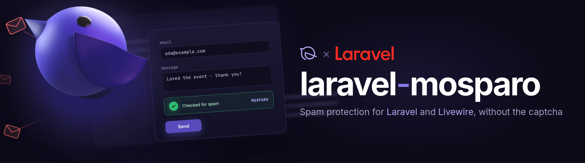

<p align="center"></p>

<p align="center">
<a href="https://packagist.org/packages/exeque/laravel-mosparo"></a>
<a href="https://packagist.org/packages/exeque/laravel-mosparo"></a>
<a href="https://github.com/ExeQue/laravel-mosparo/actions/workflows/tests.yml"></a>
<a href="https://github.com/ExeQue/laravel-mosparo/actions/workflows/docs.yml"></a>


<a href="LICENSE.md"></a>
</p>

# laravel-mosparo

**Documentation: [exeque.github.io/laravel-mosparo](https://exeque.github.io/laravel-mosparo/)**

[mosparo](https://mosparo.io) spam protection for Laravel and Livewire. Put the box in a form with one directive, and check the submission with a validation rule, a Livewire trait or a facade, naming the fields mosparo must have checked.

## Install

```bash
composer require exeque/laravel-mosparo
```

```dotenv
MOSPARO_HOST=https://mosparo.example.com
MOSPARO_UUID=your-project-uuid
MOSPARO_PUBLIC_KEY=your-public-key
MOSPARO_PRIVATE_KEY=your-private-key
```

## Use

```blade
<head>
    @mosparoScript
</head>

<form method="post" action="/newsletter">
    @csrf
    <input name="email" type="email">

    @mosparo
    @mosparoError <p class="error">{{ $message }}</p> @enderror

    <button type="submit">Subscribe</button>
</form>
```

A plain form post is checked by a validation rule:

```php
use ExeQue\Mosparo\Rules\ValidMosparo;

'_mosparo_submitToken' => [new ValidMosparo(['email'])],
```

A Livewire component uses the trait:

```php
use ExeQue\Mosparo\Livewire\Concerns\InteractsWithMosparo;
use Livewire\Component;

class SignIn extends Component
{
    use InteractsWithMosparo;

    public SignInForm $form;

    public function signIn(): void
    {
        if (! $this->mosparo->verify($this->form, ['email'])) {
            return;
        }

        // ...
    }
}
```

Anything else asks the facade:

```php
use ExeQue\Mosparo\Facades\Mosparo;

Mosparo::passes($formData, $submitToken, $validationToken, ['email', 'message']);
```

## Features

- [Statistics, rule packages and metadata](docs/data.md) as read-only data objects, with [optional caching](docs/caching.md)
- [Several mosparo projects](docs/projects.md) in one application, picked by name
- [Disabled](docs/switching-off.md) with one env key, and [faked](docs/testing.md) in your tests
- Visible and invisible boxes, started wherever they appear: Livewire updates, `wire:navigate`, the back button
- The error message in [29 European languages](docs/translations.md)
- [A workbench](CONTRIBUTING.md) with a real mosparo, through lerd or Docker

Read on in the [documentation](docs/README.md).

## License

The code is MIT; see [LICENSE.md](LICENSE.md).

The cover shows Mo, the sparrow, by [mosparo](https://mosparo.io), licensed under [CC BY-SA 4.0](https://creativecommons.org/licenses/by-sa/4.0/). The cover and the other artwork in `art/` are CC BY-SA 4.0 as well; see [art/LICENSE.md](art/LICENSE.md). mosparo and Laravel do not endorse this package.
